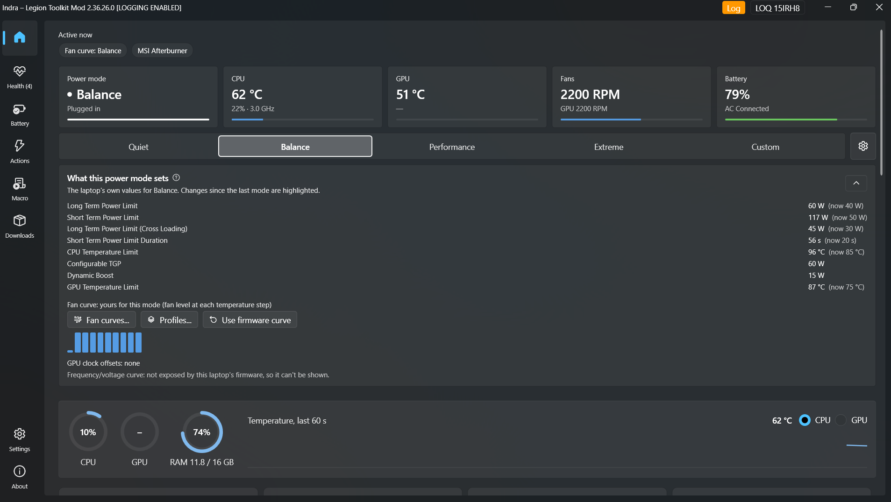

  

  # Indra – Legion Toolkit Mod

  **A fork of [Lenovo Legion Toolkit](https://github.com/LenovoLegionToolkit-Team/LenovoLegionToolkit) v2.36.0.0, developed and maintained by Nirmay Kadam**

  
  
  
  
  

> [!IMPORTANT]
> This is an **unofficial, personal modification**. It is not affiliated with, endorsed by, or supported by Lenovo or the LenovoLegionToolkit-Team. "Lenovo" and "Legion" are trademarks of Lenovo. The software comes with **no warranty** (see [LICENSE](LICENSE)). For the original app, use the [official releases](https://github.com/LenovoLegionToolkit-Team/LenovoLegionToolkit/releases).

> [!WARNING]
> **Pre-release.** Indra has so far only been tested on one laptop: a **LOQ 15IRH8** (Intel CPU, RTX 3050). It should run on the models listed below, but on other models some features may be missing or behave differently. Reports from other models are very welcome (see [Reporting a problem](#reporting-a-problem)).

## What is it?

Indra is a lightweight Windows app for Lenovo gaming laptops that replaces Lenovo Vantage, Legion Zone and Legion Space. It keeps everything Lenovo Legion Toolkit does (power modes, battery modes, keyboard lighting, display settings, automations, a command line) and adds:

- **Custom mode and fan curves:** your own power limits and a fan curve for each power mode, with a 30-second undo.
- **Power mode profiles:** what each mode changes (fan curve, Windows power plan or mode) on one page.
- **Games:** game detection, game profiles (per-game power mode, closing or slowing apps, pausing services), Game mode for any game Windows knows, and game-safe mode that steps aside while an anti-cheat game runs.
- **Game session report:** a short summary after each game (FPS, temperatures, GPU clock and power, driver errors), with history and CSV export.
- **On-screen display** with FPS, frame times and sensors, and a quick toggle.
- **A calmer, safer app:** safe start after a crash, a freeze watchdog, a health check of your Windows settings, and a read-only safety report of what Indra changed.
- **Three looks:** Fluent glass, Neon and Retro CRT, with an animation setting and a live status strip.

## Supported laptops

Indra starts on Lenovo laptops and recognises these families: **Legion 5, Legion Slim 5, Legion Pro 5, Legion 7, Legion Pro 7, Legion 9, Legion Go, LOQ, IdeaPad Gaming** and **IdeaPad**. Each feature checks what your laptop supports and hides what it doesn't. On a laptop it can't recognise, Indra asks before going on.

**Not tested yet:** AMD laptops (the CPU overclocking part has not been run on AMD hardware), per-key RGB (Spectrum) keyboards, the Legion Go, and laptops without an NVIDIA GPU.

## Installing

1. Download `Indra-LegionToolkitMod-Setup-v….exe` from [Releases](https://github.com/NirmayKadam/LenovoLegionToolkitMod/releases), and compare its SHA-256 with the one on the release page.
2. **Smart App Control must be off** (Windows Security → App & browser control). It doesn't trust self-made certificates, and blocks Indra.
3. Windows SmartScreen may warn about an unknown app: choose **More info → Run anyway**.
4. Run the installer. It needs administrator rights. Keep the default Program Files location.

**About the certificate:** Indra asks Windows for `uiAccess` (so its overlay and hotkeys work over other windows). Windows only starts such an app when it is signed by a certificate it trusts and installed in Program Files. Indra is signed with its own certificate, so **the installer adds that certificate to your computer's trusted root certificates**. Uninstalling Indra removes it again.

**If you used Lenovo Legion Toolkit before:** close it first. Indra keeps its settings in its install folder.

## Updates

Settings → Updates checks this fork's releases and opens the release page; it never downloads or installs anything by itself. **Pre-releases are only offered on the Beta channel**; the default Stable channel gets normal releases only.

## Reporting a problem

Open an [issue](https://github.com/NirmayKadam/LenovoLegionToolkitMod/issues) with your laptop model and what happened. These help a lot:

- **The log:** Settings → App behaviour → Detailed log, reproduce the problem, then the log folder (it can contain program and Wi-Fi network names, so read it before sharing).
- **The safety report:** Settings → App behaviour → Safety report → Copy.

## Documentation

- [User guide](docs/USER-GUIDE.md): every page, the command line, startup options, where data lives, troubleshooting.
- [Safety](docs/SAFETY.md): what Indra writes, and how to undo it.
- [Building](docs/BUILDING.md): building and testing it yourself.

## Credits

- **Nirmay Kadam**: developer and maintainer of Indra (this fork), 2026
- **Bartosz Cichecki**: original author of Lenovo Legion Toolkit
- **LenovoLegionToolkit-Team** (Kaguya, Dr. Skinner and contributors): maintainers of v2.36.0.0, on which this fork is based
- Third-party components and their licenses: [NOTICE](NOTICE)

In the app, About shows the original project's copyright and licence under **Original project and licence**.

## License

Lenovo Legion Toolkit is licensed under the **GNU General Public License v3.0**, and so is this modified version. See [LICENSE](LICENSE). The modification notice required by GPL-3.0 section 5 is in [docs/CHANGES.md](docs/CHANGES.md). Third-party components keep their own licenses ([NOTICE](NOTICE)).
