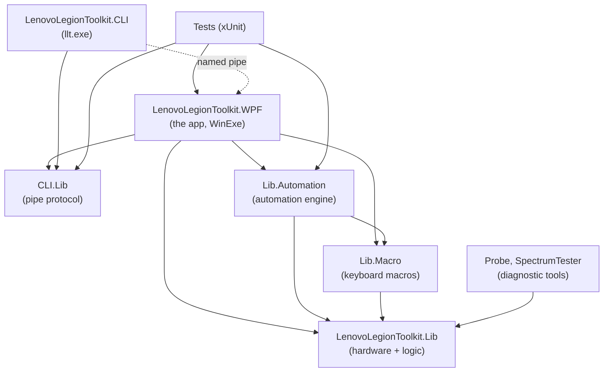
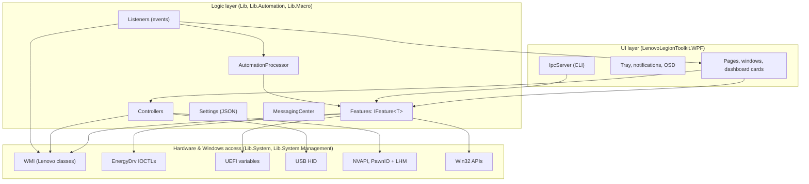
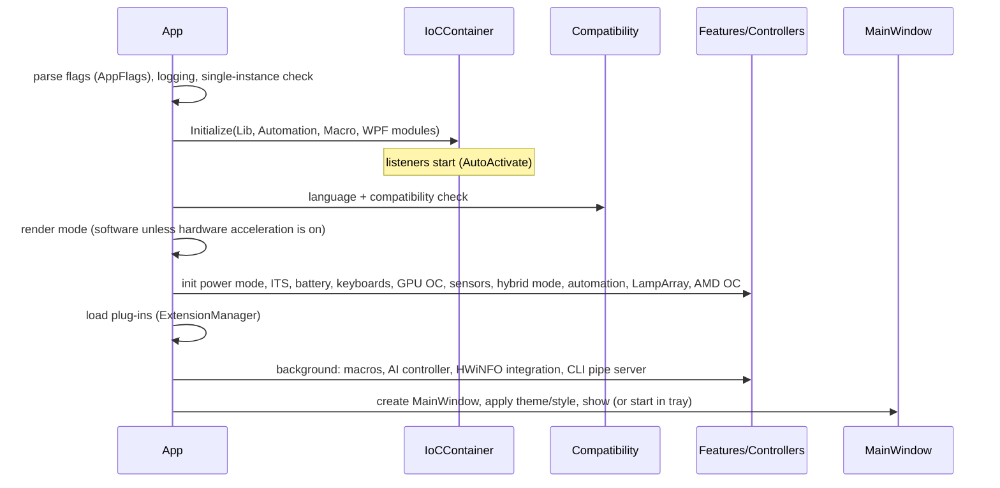
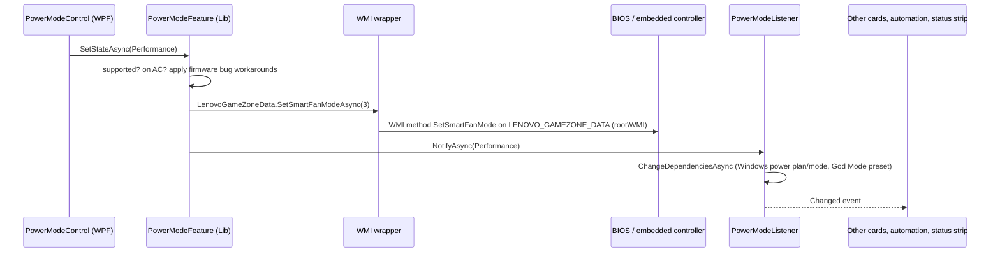
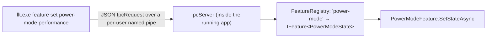

# Architecture

How Lenovo Legion Toolkit (LLT) is put together: what each project does, the few patterns that repeat everywhere, how the app talks to the laptop's hardware, and how a click or a key press travels through the code.

New to C#, WPF or this kind of app? Read [CODEBASE-GUIDE.md](CODEBASE-GUIDE.md) first. It explains the technologies and gives a reading order.

## At a glance

| | |
|---|---|
| **Language** | C# (with `Nullable` enabled), plus XAML for the user interface |
| **Runtime** | .NET 9, Windows only (`net9.0-windows10.0.26100.0`), x64, Windows 10 2004 (build 19041) or newer |
| **UI framework** | WPF (Windows Presentation Foundation) with the [WPF-UI](https://github.com/lepoco/wpfui) 2.1 control library for the Windows 11 look |
| **Architecture** | Layered desktop app: a hardware/logic library under a WPF front end, with a plug-in-style automation engine and a command-line client that talks to the running app over a named pipe |
| **Key patterns** | Dependency injection (Autofac); one `IFeature<T>` interface per hardware setting; event "listeners" for hardware and Windows events; publish/subscribe messages; JSON settings files |
| **Runs as** | Administrator (the manifest asks for `requireAdministrator` and `uiAccess`), started at logon by a scheduled task |
| **Talks to hardware through** | Lenovo's WMI interfaces, Lenovo's `EnergyDrv` driver, UEFI variables, USB HID (keyboards), NVIDIA NVAPI, and the PawnIO driver with LibreHardwareMonitor (sensors) |

## The projects



| Project | Type | Files | What's in it |
|---|---|---|---|
| `LenovoLegionToolkit.Lib` | library | ~320 | Everything that touches hardware or Windows: features, controllers, listeners, settings, compatibility checks, updates, driver/BIOS package lookup, logging. **No UI.** |
| `LenovoLegionToolkit.Lib.Automation` | library | ~100 | The automation engine: pipelines, triggers ("when…") and steps ("do…") |
| `LenovoLegionToolkit.Lib.Macro` | library | ~10 | Recording and playing back keyboard macros |
| `LenovoLegionToolkit.WPF` | Windows app | ~390 | The user interface: windows, pages, dashboard cards, settings, tray icon, notifications, OSD, the pipe server for the CLI, styles and themes |
| `LenovoLegionToolkit.CLI` | console app | 3 | `llt.exe`, which sends commands to the running app |
| `LenovoLegionToolkit.CLI.Lib` | library | 7 | Request/response types and the pipe protocol shared by the CLI and the app |
| `LenovoLegionToolkit.Probe` | console app | 1 | Scans a laptop for known Lenovo gaming features (for support and new-model work) |
| `LenovoLegionToolkit.SpectrumTester` | console app | 1 | Tests Spectrum (per-key RGB) keyboards |
| `LenovoLegionToolkit.LampArray` | packaging project | — | Windows package identity for the Dynamic Lighting (LampArray) integration; needs Visual Studio's MSBuild |
| `LenovoLegionToolkit.Tests` | xUnit tests | ~25 | Automated tests (see [TESTING.md](TESTING.md)) |

Shared build settings (version, target framework, output folder `BuildLLT\`) live in `Directory.Build.props`.

## Main libraries

| Package | Used for |
|---|---|
| Autofac | Dependency injection container (`IoCContainer`, `IoCModule` in each project) |
| System.Management | WMI queries, method calls and event subscriptions |
| Microsoft.Windows.CsWin32 | Generates Win32 API bindings at build time (the `PInvoke.*` calls and `Windows.Win32` namespace) |
| Newtonsoft.Json | Settings files, automation pipelines, CLI messages |
| PubSub | In-process publish/subscribe (`MessagingCenter`) |
| LLT.LibreHardwareMonitorLib | Detailed CPU/GPU/memory/storage sensors (through the PawnIO driver) |
| LLT.NvAPIWrapper.Net | NVIDIA GPU state and overclocking |
| LLT.WindowsDisplayAPI | Display modes, refresh rate, HDR |
| LLT.PresentMonFps | FPS counter for the OSD |
| LLT.ZenStates-Core | AMD CPU overclocking |
| Octokit | Checking GitHub for updates |
| TaskScheduler | The "start at logon" scheduled task |
| NAudio.Wasapi, ManagedNativeWifi, CoordinateSharp | Audio devices, Wi-Fi state, sunrise/sunset times for automation |
| WPF-UI, Humanizer, Markdig.Wpf, PixiEditor.ColorPicker, XamlAnimatedGif | UI controls, friendly text, release notes, color picker, animated GIFs |
| System.CommandLine | Argument parsing in `llt.exe` |

The five `LLT.*` packages are the upstream team's forks, pinned on purpose (see [BUILDING.md](BUILDING.md)).

## Layers



The rule of thumb: **`Lib` never references WPF.** The UI asks `Lib` to read or change things, and `Lib` reports changes back through events and messages.

## The core patterns

Once you know these six, most of the codebase reads the same way.

### 1. Features: one class per hardware setting

`LenovoLegionToolkit.Lib/Features/IFeature.cs`:

```csharp
public interface IFeature<T> where T : struct
{
    Task<bool> IsSupportedAsync();   // does this laptop have it?
    Task<T[]> GetAllStatesAsync();   // which values are possible here?
    Task<T> GetStateAsync();         // current value
    Task SetStateAsync(T state);     // change it
}
```

`T` is an enum describing the setting, for example `FnLockState { Off, On }` or `PowerModeState { Quiet, Balance, Performance, Extreme, GodMode }` (in `Lib/Enums.cs`). There are about 60 features: power mode, battery mode, Fn Lock, Win key lock, touchpad lock, hybrid graphics, overdrive, refresh rate, HDR, keyboard backlight levels and more.

Most features don't implement the interface directly. They derive from a base class that matches **how** the setting reaches the hardware:

| Base class | Hardware channel | Example |
|---|---|---|
| `AbstractWmiFeature<T>` | A Lenovo WMI method (get/set functions passed in) | `PowerModeFeature` → `LENOVO_GAMEZONE_DATA.SetSmartFanMode` |
| `AbstractDriverFeature<T>` | A `DeviceIoControl` call to Lenovo's `\\.\EnergyDrv` driver | `FnLockFeature`, `BatteryFeature` |
| `AbstractCapabilityFeature<T>` | `LENOVO_OTHER_METHOD` Get/SetFeatureValue with a capability ID | newer-model features |
| `AbstractUEFIFeature<T>` | UEFI firmware variables (`Get/SetFirmwareEnvironmentVariableEx`) | `FlipToStartUEFIFeature` |
| `AbstractLenovoLightingFeature<T>` | Lenovo lighting WMI methods | panel logo, ports backlight |
| `AbstractCompositeFeature<T>` | Tries several implementations and uses the first that's supported | features that changed between laptop generations |

### 2. Controllers: bigger hardware jobs

Controllers (`Lib/Controllers/`) hold logic that doesn't fit "one setting with a few values":

- `GodModeController`: custom power limits and fan curves, with presets;
- `SensorsController`: picks one of six generations (`SensorsControllerV0`…`V5`) by asking each whether this laptop supports it;
- `GPUController`, `GPUOverclockController`: the discrete GPU;
- `RGBKeyboardBacklightController`, `SpectrumKeyboardBacklightController`, `LampArrayController`: keyboard lighting;
- `WindowsPowerPlanController`, `WindowsPowerModeController`: keeping the Windows power plan in step with the laptop's mode;
- `AIController`, `SmartFnLockController`, `DisplayBrightnessController`.

### 3. Listeners: things that happen on their own

`IListener<TEventArgs>` (`Lib/Listeners/IListener.cs`) has a `Changed` event plus `StartAsync`/`StopAsync`. Listeners turn outside events into C# events:

| Listener | Source | Fires when |
|---|---|---|
| `PowerModeListener` | WMI event `LENOVO_GAMEZONE_SMART_FAN_MODE_EVENT` | the power mode changes (app, Fn+Q, BIOS) |
| `ThermalModeListener` | WMI event `LENOVO_GAMEZONE_THERMAL_MODE_EVENT` | the firmware's thermal mode changes |
| `SpecialKeyListener` | WMI event `LENOVO_UTILITY_EVENT` | special Fn-key combinations are pressed (Fn Lock, camera, …) |
| `DriverKeyListener` | Lenovo `EnergyDrv` driver key wait handle | keys reported by the driver |
| `PowerStateListener` | Windows power notifications | AC plugged/unplugged, low-wattage adapter, sleep/resume |
| `NativeWindowsMessageListener` | Windows messages and power-setting notifications | lid opened/closed, display on/off, devices plugged in |
| `DisplayConfigurationListener` | Windows display events | displays connected or changed |
| `SystemThemeListener` | Registry (`AppsUseLightTheme`, DWM colorization) | Windows switches light/dark or accent color |

WMI-based listeners derive from `AbstractWMIListener`, which wraps a `ManagementEventWatcher`. Most listeners are registered with `.AutoActivateListener()` in `Lib/IoCModule.cs`, which starts them as soon as the container is built.

**Auto-listeners** (`Lib/AutoListeners/`) are a second kind used by the automation engine: process started/stopped, game detected, time of day, battery level, Wi-Fi, user inactivity.

### 4. Dependency injection

Every project has an `IoCModule` (an Autofac module) that registers its classes:

```csharp
builder.Register<PowerModeFeature>();                          // Lib/IoCModule.cs
builder.Register<PowerModeListener>().AutoActivateListener();  // start immediately
```

`Register<T>()` (`Lib/Extensions/ContainerBuilderExtensions.cs`) registers the class as a **single shared instance**, both as itself and as every interface it implements. So `PowerModeFeature` is also available as `IFeature<PowerModeState>`.

- `Lib` classes receive their dependencies through constructors. They use C# 12 primary constructors: `public class PowerModeFeature(GodModeController godModeController, …)`.
- WPF controls fetch what they need from the static `IoCContainer.Resolve<T>()` (a "service locator"), because XAML creates controls without constructor arguments.

The container is built once at startup with four modules: `Lib`, `Lib.Automation`, `Lib.Macro` and `WPF`.

### 5. Messages

`MessagingCenter` (`Lib/Messaging/`) is a small publish/subscribe hub over the PubSub package. Anything can `Publish(new NotificationMessage(...))`, and anything subscribed to that message type receives it, without the two knowing about each other. Examples:

- `NotificationMessage`: show an OSD/notification;
- `FeatureStateMessage<T>`: a feature changed outside its card;
- `SensorDashboardSwappedMessage`, `OsdChangedMessage`, …

### 6. Settings

Each settings area is a class deriving from `AbstractSettings<TStore>` (`Lib/Settings/AbstractSettings.cs`). It loads a JSON file into a plain `Store` object, and `SynchronizeStore()` writes it back atomically.

| File | Class |
|---|---|
| `settings.json` | `ApplicationSettings`: theme, style, behavior, power-plan mapping, … |
| `godmode.json` | `GodModeSettings`: presets |
| `automation.json` | `AutomationSettings`: pipelines |
| `dashboard.json` | `DashboardSettings`: dashboard layout |
| `rgb_keyboard.json`, `spectrum_keyboard.json`, `lamp_array.json` | keyboard lighting |
| `macro.json`, `osd.json`, `notification_settings.json`, `special_key.json`, `integrations.json`, `update_settings.json`, … | the rest |

**Where they live** (`Lib/Utils/Folders.cs`): an installed, elevated copy uses `<install folder>\UserData\<your Windows user SID>\`. Only administrators can change that folder; this mod added it as a security fix. Portable copies and Debug runs use `%LOCALAPPDATA%\LenovoLegionToolkit\`. Logs always go to `%LOCALAPPDATA%\LenovoLegionToolkit\log\`.

Settings files may only contain LLT's own types and simple values (`SafeSerializationBinder`). That stops a tampered file from running code while it loads.

## Knowing which laptop it is

`Lib/Utils/Compatibility.cs` reads the vendor, model and machine type over WMI and builds a `MachineInformation`:

- **Allowed hardware:** the vendor must be `LENOVO` or `MOTOROLA`, and the model must start with an allowed prefix. Otherwise the app shows the "unsupported" window, unless it's started with `--skip-compat-check`.
- **Series:** `MachineTypeMap` maps machine types (like `83F0`) to a `LegionSeries` (Legion 5, Slim 5, Pro 5, 7, LOQ, …).
- **Capabilities:** `MachineInformation.Properties` lists capability flags (`SupportsGodMode`, `SupportsExtremeMode`, `SupportsAIMode`, `SupportsITSMode`, …).
- **Bug workarounds:** it also lists known firmware bugs that the code works around (`HasQuietToPerformanceModeSwitchingBug`, `HasGodModeToOtherModeSwitchingBug`).

Features check these before offering a value. For example, `PowerModeFeature.GetAllStatesAsync()` only adds Extreme and Custom when the laptop supports them.

## Startup

`App.xaml.cs`, `Application_Startup`:



Each hardware init step is wrapped in `SafeInitAsync`, so one failing feature doesn't stop the app.

## Walkthrough 1: picking a power mode on the dashboard



In code:

1. `PowerModeControl` derives from `AbstractComboBoxFeatureCardControl<PowerModeState>` (`WPF/Controls/AbstractComboBoxFeatureCardControl.cs`). That generic card resolves `IFeature<PowerModeState>` from the container, fills a combo box from `GetAllStatesAsync()`, and calls `SetStateAsync()` when the selection changes.
2. `PowerModeFeature.SetStateAsync` (`Lib/Features/PowerModeFeature.cs`) does the checks. It then calls the base `AbstractWmiFeature.SetStateAsync`, which adds the offset (the firmware counts from 1) and calls the WMI function it was given.
3. `WMI.LenovoGameZoneData.SetSmartFanModeAsync` (`Lib/System/Management/WMI.LenovoGameZoneData.cs`) runs a WMI method call through the generic `WMI.CallAsync` helper in `WMI.cs`.
4. `PowerModeListener.NotifyAsync` updates the dependent settings and raises `Changed`. The dashboard cards, the automation engine (power-mode triggers) and the status strip are all subscribed.

## Walkthrough 2: pressing Fn+Q

The firmware changes the mode itself, then raises the WMI event `LENOVO_GAMEZONE_SMART_FAN_MODE_EVENT`:

1. `PowerModeListener`, an `AbstractWMIListener` started at boot, receives it.
2. Its `OnChangedAsync` runs `ChangeDependenciesAsync`, then publishes a `NotificationMessage`. `NotificationsManager` (WPF) is subscribed and shows the "Performance mode" pop-up.
3. It raises `Changed`, so every subscriber refreshes, exactly as in walkthrough 1.

## The automation engine

`Lib.Automation`: "when **X** happens, do **Y**".

- **`AutomationPipeline`:** a name, a `Trigger` (`IAutomationPipelineTrigger`) and a list of `Steps` (`IAutomationStep`). Pipelines are saved in `automation.json`.
- **Triggers** (`Pipeline/Triggers/`, about 35): AC connected/disconnected, battery percentage, power mode changed, game or process started/stopped, time or time range (including sunrise/sunset), Wi-Fi connected, display on/off, external display, lid, session lock, user inactivity, startup, resume, periodic. `And`/`Or` triggers combine them.
- **Steps** (`Steps/`, about 50): set any feature (`AbstractFeatureAutomationStep<T>` wraps an `IFeature<T>`), God Mode preset, refresh rate, resolution, run a program, play a macro, notification, delay, and more.
- **`AutomationProcessor`:** subscribes to the listeners and auto-listeners and turns each event into an `IAutomationEvent`. It asks each pipeline's trigger `IsMatchingEvent(...)` and runs the matching pipelines' steps in order, with cancellation.

The editor UI is the **Actions** page, `WPF/Pages/AutomationPage.xaml(.cs)`. `WPF/Controls/Automation/AutomationPipelineControl.cs` maps each step type to its editor control (`FnLockAutomationStep s => new FnLockAutomationStepControl(s)`).

## The command line (`llt.exe`)



- **Commands:** `quickAction`, `feature list/get/set`, `spectrum profile/brightness`, `rgb get/set` (`CLI/Program.cs`).
- **Operations:** the request types are listed in `CLI.Lib/IpcRequest.cs` (`ListFeatures`, `GetFeatureValue`, `SetFeatureValue`, `QuickAction`, …).
- **Feature names:** kebab-case, registered in `WPF/CLI/Features/FeatureRegistry.cs`, e.g. `new FeatureRegistration<FnLockState>("fn-lock")`.
- **Security:** the pipe name includes the user's SID, only that user can connect, and the client checks that the server process really is LLT (`CLI.Lib/PipeServerIdentity.cs`).
- **Off by default:** the server only runs when the CLI is enabled in Settings → Integrations (`IntegrationsSettings.CLI`, checked in `IpcServer.StartStopIfNeededAsync`).

## Plug-ins ("Station")

`Lib/Station` (interfaces) and `WPF/Station` (implementation) form a small extension system. A plug-in implements `IExtensionProvider` (`Initialize`, `ExecuteAsync`, `GetData`/`SetData`). Through `IExtensionContext` it can add automation steps and triggers, navigation entries and UI work. `ExtensionManager` loads plug-in DLLs from the install folder only (a security fix in this mod; see [SECURITY.md](SECURITY.md)).

## The user interface

- **`App.xaml`:** merges WPF-UI's theme and controls dictionaries and the app's styles (`WPF/Styles/`).
- **`MainWindow`:** a WPF-UI `NavigationStore` (the left rail) driving a `Frame` that shows the **pages** (`WPF/Pages/`): Dashboard, Battery, Keyboard (`KeyboardBacklightPage`, or `LampArrayRGBKeyboardPage` on Dynamic Lighting models), Actions (`AutomationPage`), Macro, Downloads (`PackagesPage`), Settings, About, Donate.
- **Dashboard:**
  - groups of cards (`DashboardGroupControl`);
  - each card is a `DashboardItem` (`WPF/Enums.cs`) mapped to its control in `WPF/Extensions/DashboardItemExtensions.cs`;
  - simple cards derive from `AbstractToggleFeatureCardControl<T>` or `AbstractComboBoxFeatureCardControl<T>`;
  - the layout is saved in `dashboard.json`;
  - above the cards: the sensors section and this mod's status strip.
- **Settings:** one control per tab in `WPF/Controls/Settings/`: app behavior, appearance, display, integrations, power, software control, special keys, updates.
- **Windows** (`WPF/Windows/`): dialogs like God Mode settings, OSD windows, notification pop-ups, the update window.
- **Tray and notifications:** `TrayHelper`/`NotifyIcon`; `NotificationsManager` turns `NotificationMessage`s into pop-ups.
- **Look:** `ThemeManager` applies light/dark, the accent and this mod's styles (Fluent, Neon, Retro). `Motion` decides how much animates. See [SKINS.md](SKINS.md).
- **Text:** all user-visible text lives in `Resources/Resource.resx` (per project), translated through Crowdin (`*.xx.resx`). The `Resource.Designer.cs` files are maintained by hand in this repo; add a property when you add a string.

## Services added in this mod (OSD toggle, game-safe mode, help, power details, fan curves)

| Piece | Where | What it does |
|---|---|---|
| Hover help | `WPF/Controls/Help/HelpContent.cs`, `HelpPresenter.cs`, `CardHeaderControl.HelpKey` | A card names a help key; `HelpContent.Resolve` reads `<key>_What`, `_When` and `_Risk` from `Resource.resx` at run time (no Designer property needed). `CardHeaderControl` draws the ⓘ, the tooltip, keyboard focus and `AutomationProperties.HelpText`. Feature cards default to `Help_Feature_<state type>`, automation actions to `Help_Step_<type>`, triggers to `Help_Trigger_<type>`, dashboard items via `DashboardItemExtensions.GetHelpKey`. |
| OSD hotkey | `WPF/Utils/GlobalHotkeyService.cs`, `WPF/Utils/HotkeyGesture.cs`, `Lib/Settings/HotkeyBinding.cs` | `RegisterHotKey` on a message-only window (no hook). `WM_HOTKEY` publishes `OsdChangedMessage(Toggle)`, handled by `App.HandleOsdCommand`. |
| OSD Fn key | `Lib.Automation/QuickActionTemplates.cs` | Builds the "Toggle OSD" quick action (one `OsdAutomationStep(Toggle)`) that special keys can run. |
| Game-safe mode | `Lib/Utils/AntiCheatMonitor.cs`, `WPF/Utils/GameSafeMode.cs` | Polls the status of the `vgc`, `EasyAntiCheat`, `EasyAntiCheat_EOS` and `BEService` services every 5 s. Switches one at a time (a `SemaphoreSlim`; the service check and the Settings toggle can both ask). `MacroController.Suspend`/`Resume` may be called from any thread: the hook is installed and removed on the thread that called `Start` (its `SynchronizationContext`). While one runs: `SensorsGroupController.SetPaused(true)`, `MacroController.Suspend()`, `NativeWindowsMessageListener.SetKeyboardHookSuspendedAsync(true)`, and the OSD builds its snapshot without the driver (`WPF/Windows/Osd/OsdSnapshotBuilder.cs`, `Lib/System/SystemMemory.cs`) and shows its GAME-SAFE label. `FpsSensorController` finds the game through `Process.GetProcesses()` rather than opening it. |
| Idle detection | `Lib/AutoListeners/UserInactivityAutoListener.cs` | Detects input with `GetLastInputInfo` once a second; a 10 s timer counts idle steps. No low-level hooks. |
| Power mode details | `Lib/Controllers/PowerModeProfileReader.cs`, `WPF/Controls/Dashboard/PowerModeDetailsControl.xaml(.cs)`, `PowerModeDetailsFormat.cs` | Builds a `PowerModeProfile` per mode from `GodModeController.GetDefaultsInOtherPowerModesAsync` (built-in modes) or the active preset (Custom), reads live values from `WMI.LenovoCpuMethod`/`LenovoGpuMethod` for the current mode, and diffs two profiles. Refreshes on `PowerModeListener.Changed` and preset changes. |
| Fan curves per mode | `Lib/Settings/FanProfileSettings.cs` (`fan_profiles.json`), `Lib/Controllers/FanProfileController.cs`, `WPF/Windows/Dashboard/FanCurvesWindow.xaml(.cs)` | On every `PowerModeListener.Changed`, writes the mode's curve through `IFanTableAccess` (real: `GodModeFanTableAccess` → `SetFanTableWithVerifyAsync`), and reports as soon as that read-back matches. The re-check (`RecheckDelay`, 3 s; read back with `FanGetTableAsync`; one rewrite if reverted; a second `Applied` event with `Rejected` if reverted again) runs in the background as `WatchAsync`, which keeps the one-at-a-time lock until it ends (`PendingCheck` exposes it to tests). `ProbeAsync` (Test now) reads the table first, writes, checks once, then writes the earlier table back (`FanCurveProbeResult.NeedsModeReapply` when it can't, e.g. below the minimum). `PreviewAsync` (Apply now) is an apply with the editor's curve and nothing saved. Also applied once at start and after resume. **One apply at a time:** a newer mode change cancels the running one, and before each write and each verdict the controller re-reads the current power mode and stops (`Superseded`) if the laptop has left the curve's mode. A failed call is `Failed`, not `Rejected`. `FanCurveFirmwareSupport` is saved **only** by the user-started test (`ProbeAsync`); on `Rejects` applies stop and the window offers `BuildCustomPreset`, placed with `UpsertFallbackPreset` (one preset per mode, tracked in `FallbackPresetIds`). |
| GPU overclock crash guard | `Lib/Controllers/OverclockApplyGuard.cs`, `Lib/Controllers/GPUOverclockController.cs`, `Lib/Settings/GPUOverclockSettings.cs` (`gpu_oc.json`) | Before unproven values go to the driver, `Begin` saves `PendingInfo`. After `StabilityWindow` (60 s) `ConfirmStable` moves them to `StableInfo`; a normal exit calls `Abandon`. A run that finds `PendingInfo` left over (`RecoverFromInterruptedApply`, checked in `GetState` and `ApplyStateAsync`) turns the overclock off and sets `DisabledAfterInterruptedApply`. Clock offsets are clamped to the driver's reported range (`ClampDeltaMhz`), the voltage lock to the top of the GPU's own V/F curve (`ClampVoltageLockMv`; not sent when unreadable). `ApplyStateAsync` returns a `GPUOverclockApplyResult`. |
| God Mode range check | `Lib/Controllers/GodMode/GodModeController.cs`, `Lib/Utils/ReadOnceCache.cs` | `ApplyState*Async` sends values from `GetRangeCheckedPresetAsync` (the saved preset put through `CreateStepperValue` against the firmware's ranges, which are read once per run in a `ReadOnceCache` and forgotten on resume via `ForgetFirmwareRanges`), not raw from `godmode.json`; only saved settings are sent (`OnlyIfSaved`); if the ranges can't be read no limits are sent but the fan step runs. Min/max offsets can only narrow the range. A failed limit no longer skips the fan step; the error is rethrown after it. |
| Settings backups | `Lib/Settings/AbstractSettings.cs` | An unreadable file is copied next to itself once per distinct content, at most `MAX_BACKUPS` (5) kept; leftover `.tmp` files older than a day are removed on save. |

| Shared readings | `Lib/Utils/SharedReading.cs`, `SensorsController`, `Battery` | Callers within 750 ms share one real sensor/battery read (and a read in progress); failures aren't kept. |
| WMI | `Lib/System/Management/WMI.cs` | `QueryAsync`/`InvokeAsync` release the searcher, results and method parameters right after reading; everything WMI goes through them. |
| Animation frame rate | `WPF/Utils/Motion.cs` (`CapAnimationFrameRate`), `App.Application_Startup` | Every animation defaults to 30 fps. Loading rings (`LoadableControl`, package download, fan-curves busy) animate only while visible and busy. |

See `docs/SAFETY.md` for every write LLT makes and how to undo it.

Startup order in `App.xaml.cs`: `InitOsd()`, `GlobalHotkeyService.Start()`, `GameSafeMode.Start()`, `StartFanProfiles()`, then `InitAppMessages()`.

## Threading

- Hardware calls are `async`. `Lib` uses `ConfigureAwait(false)` so it never needs the UI thread.
- Listener events arrive on background threads. UI code switches back with `Dispatcher.Invoke`/`InvokeAsync` before touching controls.
- Bursts of events are throttled with `ThrottleLastDispatcher`/`ThrottleFirstDispatcher` (`Lib/Utils/`).
- `AbstractDriverFeature` serializes driver calls with a global lock; `AbstractCompositeFeature` uses an `AsyncLock`.

## Logging and diagnostics

- **Logging:** `Log.Instance.Trace($"…")` is everywhere. Logs are written only when tracing is on: the `--trace` flag, or Settings → enable logging. Files are `%LOCALAPPDATA%\LenovoLegionToolkit\log\log_<date>.txt`.
- **`--debug`:** opens a console window with startup progress, and makes `AbstractWmiFeature` report every feature as supported, so you can explore the UI on any PC.
- **Other flags:** `--minimized`, `--skip-compat-check`, `--disable-update-checker`, `--allow-all-power-modes-on-battery`, `--force-disable-rgbkb`, `--force-disable-spectrumkb`, `--force-disable-lenovolighting`, `--experimental-its-mode`, `--experimental-gpu-working-mode`, `--enable-lamp-array`, the `--proxy-*` options and others (all in `Lib/Utils/AppFlags.cs`). `--proxy-allow-all-certs` is ignored in this mod.
- **Tools:** `Probe.exe` lists which Lenovo features a laptop exposes; `SpectrumTester.exe` exercises Spectrum keyboards.

## Where to change what

| I want to… | Start here |
|---|---|
| Support a new laptop model | `Lib/Utils/Compatibility.cs` (model prefixes, machine types, capability flags) |
| Add or fix a hardware setting | `Lib/Features/`, then [CODEBASE-GUIDE.md § Adding a feature](CODEBASE-GUIDE.md#5-worked-example-how-fn-lock-is-wired-end-to-end) |
| Change God Mode / fan curves | `Lib/Controllers/GodMode/`, `WPF/Windows/Dashboard/GodModeSettingsWindow.xaml(.cs)`; per-mode curves: `Lib/Controllers/FanProfileController.cs` |
| Add or change hover help | `WPF/Resources/Resource.resx` (`Help_*_What/_When/_Risk`), `HelpKey` on the card; `Tests/UI/HelpCoverageTests.cs` fails if a card has none |
| Change what game-safe mode pauses | `WPF/Utils/GameSafeMode.cs`, `Lib/Utils/AntiCheatMonitor.cs` |
| Change sensors | `Lib/Controllers/Sensors/`, `WPF/Controls/Dashboard/SensorsControl*.xaml(.cs)` |
| Add an automation trigger or step | `Lib.Automation/Pipeline/Triggers/`, `Lib.Automation/Steps/`, `WPF/Controls/Automation/` |
| Change the dashboard | `WPF/Pages/DashboardPage.xaml(.cs)`, `WPF/Controls/Dashboard/` |
| Change colors, styles or animations | `WPF/Utils/Skins/`, `WPF/Utils/ThemeManager.cs`, `WPF/Utils/Motion.cs`, `WPF/Styles/` |
| Add a CLI command | `CLI/Program.cs`, `CLI.Lib/IpcRequest.cs`, `WPF/CLI/IpcServer.cs` |
| Change where settings are stored | `Lib/Utils/Folders.cs`, `Lib/Settings/AbstractSettings.cs` |
